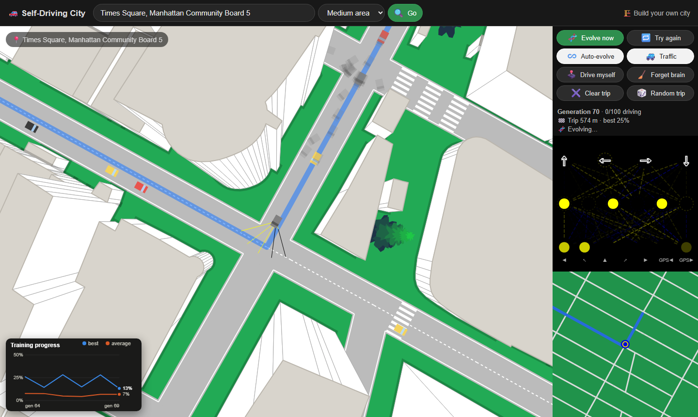
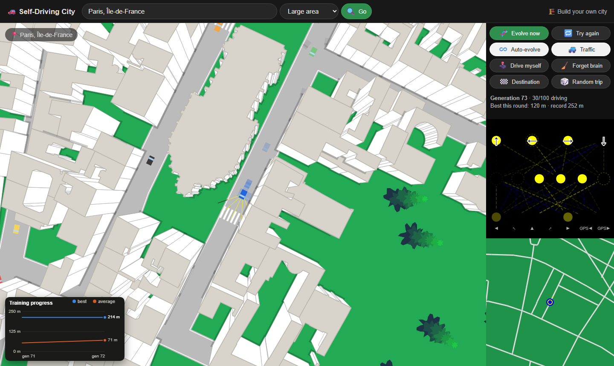
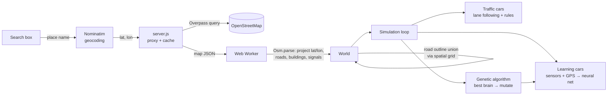

# Self-Driving City

[](https://github.com/coltonmartinn/self-driving-car/actions/workflows/test.yml)

Type in any real place (a city, an address, a zip code) and watch 100 neural-network cars learn to drive its actual streets by trial and error, sharing the road with traffic that already follows the rules. Give them a destination and they learn to follow GPS directions to get there.

Plain JavaScript and HTML canvas, **no libraries and no build step**. It started from Radu Mariescu-Istodor's freeCodeCamp course [Build a Virtual World Filled with Self-Driving Cars](https://www.youtube.com/watch?v=5iHejdqYIa8) and grew well beyond it: real map data, route-following brains, rule-based traffic, a spatial index, a Web Worker pipeline and a test suite.



| Paris, from real OpenStreetMap data | Build your own city |
| --- | --- |
|  |  |

## Quick start

Requires [Node.js](https://nodejs.org) 22 or newer (nothing to install).

```
node server.js        # or double-click start.bat on Windows
```

Open http://localhost:8080, search for a place, and press **🎲 Random trip**.

Run the tests with `npm test`.

## What it does

- **Real places.** Search is geocoded with [Nominatim](https://nominatim.org). Roads, building footprints (with real heights where mapped), traffic signals, stop and yield signs and crosswalks are downloaded from the [Overpass API](https://overpass-api.de) and turned into a drivable world. One-way streets stay one-way, and dead ends become cul-de-sacs.
- **Cars that learn.** Each car sees through 5 sensor rays and gets 2 GPS signals ("the route bends left / right"). A small neural network (7 → 6 → 4) decides gas, steering and brake. After each generation the best brain is copied and mutated for the next 100 cars, which is a simple genetic algorithm.
- **Navigation.** Pick a destination on the map or minimap. An A* search finds the route (respecting one-way streets), and cars are scored by progress along it. Wrong turns and stalls end a car's run, and arrivals are ranked by speed.
- **Traffic that already knows how to drive.** Rule-based cars follow their lane, choose turns at intersections, keep a safe gap, stop at red lights and stop signs, yield, and U-turn in cul-de-sacs.
- **Live insight.** The best car's network is drawn in real time, and a chart tracks the best and average score per generation.
- **City builder.** Draw roads and place markings by hand, generate a random town, or start from a real place and edit it.

## How it works



| Piece | Where | Notes |
| --- | --- | --- |
| Geometry | `js/primitives`, `js/math/utils.js` | Segments, polygons, a crossing-number point-in-polygon test, polygon union for road outlines |
| Spatial index | `js/math/spatialGrid.js` | Uniform grid that makes the road union, collision checks and rendering scale to large cities |
| Map import | `js/math/osm.js`, `js/places.js` | Local tangent-plane projection (10 units per meter), road and building parsing, real signals snapped to intersections |
| Background build | `js/worldWorker.js` | City building runs off the main thread: about 18 ms of page blocking for a 1,000-segment city |
| Route finding | `js/math/pathfinding.js` | A* with a binary heap; the route measures progress and gives GPS steering hints |
| Learning | `js/car/network.js`, `js/car/car.js`, `js/car/sensor.js` | Feed-forward network with step activation, mutation-based evolution, ray-cast sensors |
| Traffic | `js/car/trafficCar.js` | Pure-pursuit steering along lanes, car following, light and stop-sign logic, deadlock recovery |
| Server | `server.js` | Static files, an Overpass proxy with a proper User-Agent and server fallback, and an on-disk cache |
| Tests | `tests/` | 33 tests using `node:test`, loading the browser scripts into a `vm` sandbox; CI runs Node 22 and 24 |

## Engineering notes

- **Scaling the geometry.** Merging road shapes into one outline compared every road with every other road, so the work grew quadratically with city size. Bucketing shapes in a spatial grid means each road is only compared with its neighbours, and Paris (about 1,000 road pieces) builds in under a second, and moving the build to a Web Worker keeps the page responsive while it runs.
- **A bug the tests caught.** The original ray-casting point-in-polygon check miscounted when its ray passed exactly through a corner, so the center of a square at the origin was reported as outside. It was replaced with the crossing-number rule, which counts each edge's lower end but not its upper end.
- **Real-world data is messy.** Real streets are narrower than the simulated 14 m roads, so dropping every building that touched a road emptied out half of Paris. Allowing up to 3 m of overlap keeps 91% of the buildings, while still removing any building a road runs through.
- **Map servers refuse browsers.** Some Overpass servers reject requests that identify as a web browser, so the small Node server forwards them with a descriptive User-Agent, tries mirror servers, and caches each area.

## Project layout

```
index.html           main app: real places, training, GPS trips
editor.html          city builder
server.js            local server and map proxy
js/
  math/              utils, graph, spatial grid, A*, OSM parser, random city generator
  primitives/        Point, Segment, Polygon, Envelope
  items/             buildings and trees (fake 3D)
  markings/          stop, yield, crossing, parking, light, start, target
  editors/           city builder tools
  car/               learning car, traffic car, sensor, neural network, visualizer
  places.js          place search and map download
  worldWorker.js     background city building
  trainingChart.js   progress chart
tests/               node:test suite
```

## Credits

Map data © [OpenStreetMap](https://www.openstreetmap.org/copyright) contributors. The course that started it: [Radu Mariescu-Istodor](https://www.youtube.com/@Radu) on freeCodeCamp.
