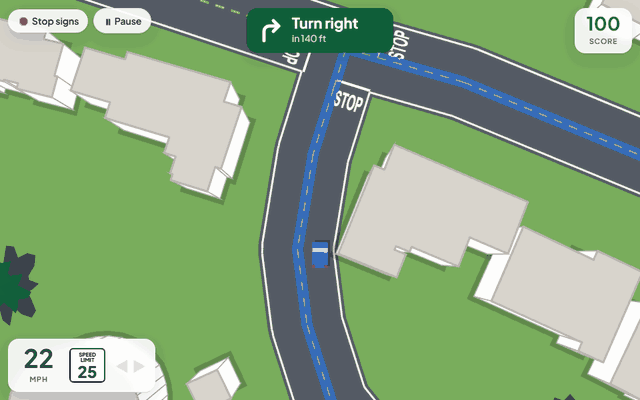
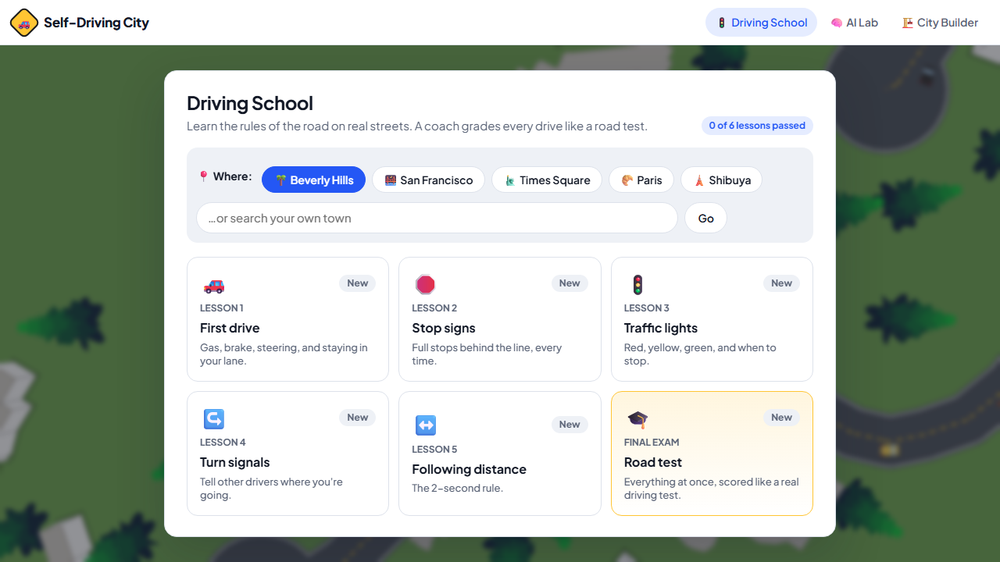
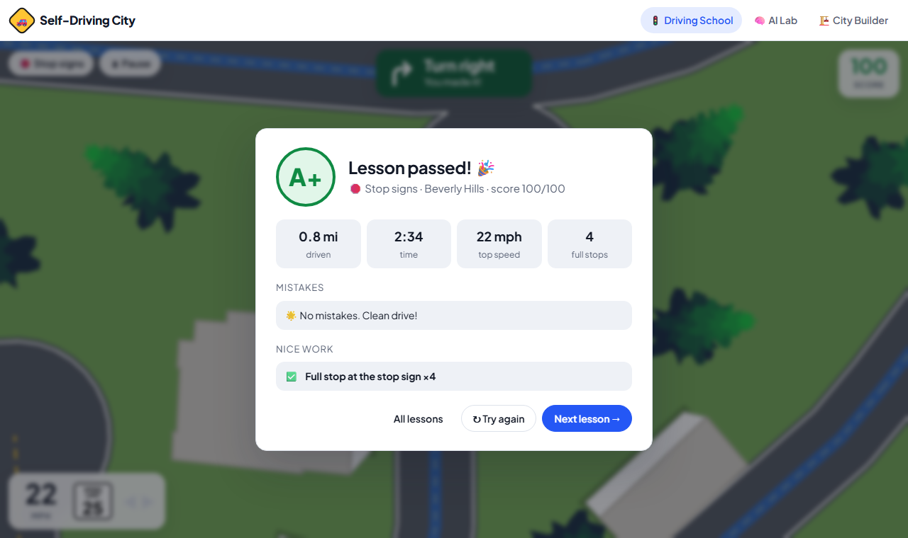
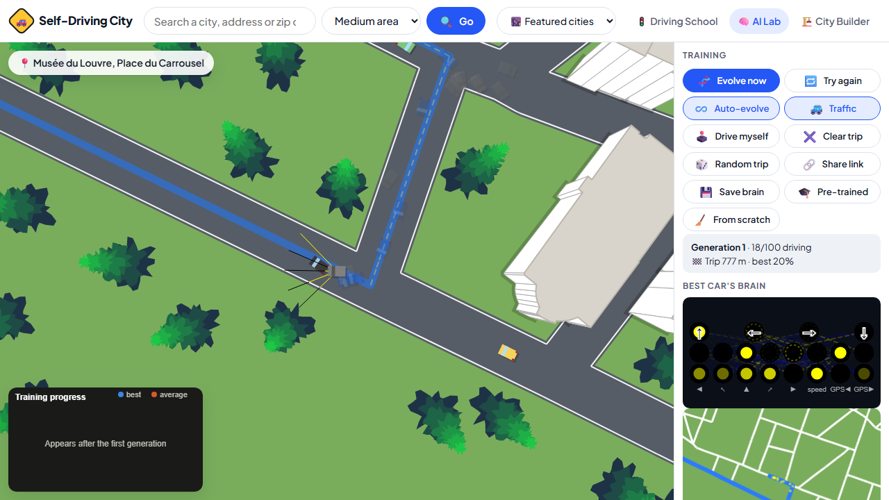
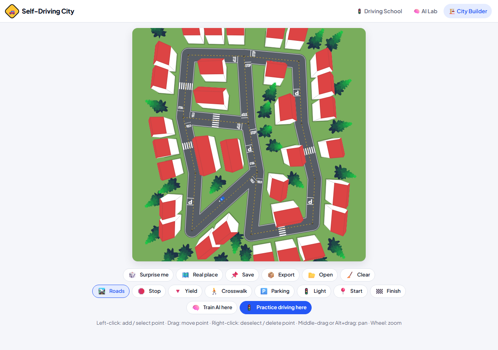
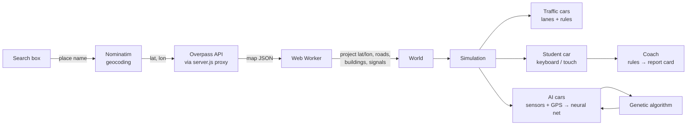

# Self-Driving City

[](https://github.com/coltonmartinn/self-driving-car/actions/workflows/test.yml)
[](https://coltonmartinn.github.io/self-driving-car/)

**Learn the rules of the road on real streets, then watch an AI learn them too.**

Self-Driving City is a driving simulator built on real OpenStreetMap data. In **Driving School**, new drivers practice everything from stop signs to parallel parking, ambulances and texts arriving mid-drive, among rule-following traffic and pedestrians. A coach grades every drive like a road test, a careful demo driver shows how each lesson is done, and every drive can be replayed with the mistakes marked. In the **AI Lab**, a hundred neural-network cars teach themselves to drive the same streets by evolution.

**▶ [Try it live](https://coltonmartinn.github.io/self-driving-car/)**. It runs in the browser, works on phones and offline, and is available in English and Spanish ([en español](https://coltonmartinn.github.io/self-driving-car/?lang=es)).



Plain JavaScript and HTML canvas, with **no libraries and no build step**. It started from Radu Mariescu-Istodor's freeCodeCamp course [Build a Virtual World Filled with Self-Driving Cars](https://www.youtube.com/watch?v=5iHejdqYIa8) and grew well beyond it.

## 🚦 Driving School

| Pick a lesson and a place | Graded like a road test |
| --- | --- |
|  |  |

Sixteen lessons, from your first drive to a final road test, in five real cities, your own town (search any place), or a city you built yourself:

| Lesson | What the coach checks |
| --- | --- |
| 🚗 First drive | Staying in your lane, speed, not hitting anything |
| 🛑 Stop signs | A full stop behind the line (rolling stops cost points; driving through fails) |
| 🚦 Traffic lights | Never crossing the stop line on red |
| ↪️ Turn signals | Signaling before each turn, and in the right direction |
| ↔️ Following distance | The 2-second rule, measured from your speed and the gap to the car ahead |
| 🚶 Crosswalks | Stopping for people on foot, and waiting until they've crossed |
| 🏫 School zones | Slowing to 15 mph between the SCHOOL signs (speeding there is a major mistake) |
| ⤵️ Pulling over | Signaling, a look over the right shoulder, then stopping inside a marked space at the curb |
| 🅿️ Parallel parking | Backing into a space between two parked cars: position, distance from the curb, angle, number of moves |
| 🔄 Roundabouts | Yielding to cars already in the ring, going counterclockwise, signaling your exit. A few of the city's junctions become roundabouts for this lesson |
| 🚚 Passing & blind spots | Getting around a double-parked truck: signal, shoulder check, wait for the other lane to clear, signal back |
| 🚑 Emergency vehicles | Pulling to the right and stopping for an ambulance with its siren on, coming towards you or from behind |
| 📱 Phone down | Texts arrive mid-drive. One forced 2-second glance shows how far you drive blind; after that, replying costs points |
| ⚠️ Hazards | Surprises with no warning: the car ahead brakes hard, someone runs into the road. Measures your reaction time |
| 🌙 Night & rain | Only headlights and streetlights to see by, wet brakes, and a 3-second following distance |
| 🎓 Road test | Everything at once. Score 80+ with no critical mistakes to pass |

**How the coach works** ([`js/school/coach.js`](js/school/coach.js)). Every frame it compares the car with the world, the way an examiner would:

- **Stop signs and lights.** It tracks the distance from the car's front bumper to each stop line ahead in its lane, records the slowest speed on approach, and judges the moment the bumper crosses the line: was the car fully stopped, and was the light red?
- **Following distance.** It finds the nearest car ahead in the same lane, going the same way, and divides the gap by your speed. Under 2 seconds for 1.5 s straight counts as tailgating.
- **Lane position.** It projects the car onto the nearest road and checks which side of the center line it's on, outside junctions and when driving along the road (so turning across a lane isn't flagged).
- **Turn signals.** It detects a turn as a big heading change while passing through a junction, then checks which signal was on during the approach. Like a real car, the signal clicks off after the turn.
- **Crosswalks.** Pedestrians wait at the curb for a safe gap, then walk across. Driving into a crosswalk while someone is on the road fails the drive, as on a real test. Traffic stops for them too.
- **Shoulder checks.** <kbd>Z</kbd> and <kbd>C</kbd> (or on-screen buttons) look over a shoulder and light up the blind spot, red if someone's in it. The coach asks for one before passing and pulling over.
- **Passing and sirens.** Moving into the other lane around a parked truck is judged as a pass (signal, shoulder check, room before oncoming traffic), not as driving on the wrong side. Near an ambulance, it watches whether you pull right and stop until it has gone by.
- **Roundabouts.** On the way in it checks for cars in the ring coming towards you (you should have yielded), inside the ring it checks which way round you're going, and on the way out whether you signaled right. Going round isn't counted as turns.
- **Crashes.** It tells apart hitting the curb, a car, or a pedestrian, and being hit while stopped (not your fault, no penalty).

Mistakes are *minor* (−3), *major* (−10) or *critical* (fails the drive), and each comes with a tip written for new drivers. The coach is plain logic with no drawing, so all of it is unit-tested in Node.

**Show me, then you try.** Every lesson has a **Show me first** button: a careful demo driver ([`js/school/autopilot.js`](js/school/autopilot.js)) drives it while a caption explains each move ("Stop sign ahead: braking early", "Siren! Pulling over to the right and stopping"). The coach grades the demo too, then the student drives the same route. The demo driver is also a test: Node runs it through all 16 lessons in all five cities, and it has to score 100.

**Instant replay.** Every drive is recorded (the car, traffic, people and the light timing) and can be watched again afterwards, with each mistake marked on the timeline and a **Watch** button next to each mistake on the report card.

**For parents and teachers.** These need no accounts and no server:

- **Progress report.** Lessons passed, practice time, recent drives, and the mistakes that keep coming up, each with a tip. It prints cleanly, and a student can send it as a link that carries the whole report.
- **Class view** ([`class.html`](class.html)). A teacher pastes the students' links to see the class in one table, the mistakes most students make (to teach next), and how much scores went up from each student's first drives to their latest. It downloads as a spreadsheet. Nothing is uploaded. To try it with a group, see the [pilot study guide](docs/pilot-study.md).
- **Permit test practice** ([`quiz.html`](quiz.html)). 40 rules-of-the-road questions (signs, signals, right-of-way, lane markings, safe driving), each with an explanation. It asks which state you live in, then adds questions on that state's teen driving laws only (the youngest age for a permit, how long to hold it, supervised hours, night and passenger limits), for all 50 states and DC, from the [IIHS licensing table](https://www.iihs.org/research-areas/teenagers/graduated-licensing-laws-table) ([`js/school/stateQuiz.js`](js/school/stateQuiz.js)).
- **Supervised practice log** ([`log.html`](log.html)). Logs real drives with a parent toward the hours your state requires (pick it from all 50 states and DC; hours from the IIHS licensing table), including night hours and conditions. It suggests what to practice next, based on the student's simulator mistakes, and exports to CSV or print.
- **Certificate and badges.** Passing the road test unlocks a printable practice certificate, and 15 badges reward milestones such as a clean drive, parallel parking, a whole Phone down lesson without touching the phone, a 90%+ permit quiz, or 5 logged real drives.
- **Installable app.** It installs to a phone, tablet or Chromebook home screen and works offline, thanks to a service worker that saves every page and city.

**Built for learning to drive.** Directions are turn-by-turn and reroute after a missed turn. The view turns with the car, so ahead is always up. US-style signs, speed limits in mph. Drive with the keyboard, on-screen pedals, or a game controller or steering wheel (analog steering and pedals). Progress is saved per lesson.

> Practice, not a substitute: this helps you learn the rules, but it doesn't replace a licensed instructor, your state's driver's manual, or supervised hours behind the wheel.

## 🧠 AI Lab



Each AI car sees through 5 sensor rays and gets its speed plus 2 GPS signals ("the route bends left / right"). A small neural network (8 → 8 → 4) chooses gas, steering and brake. After each generation, the best brains are bred, through crossover and mutation, into the next 100 cars. The best brain is drawn live, and a chart tracks progress.

**Measured, not eyeballed.** A headless trainer runs the same simulation without drawing, with seeded randomness so runs repeat exactly. [The experiments](docs/experiments/README.md) compare four setups over 3 seeds each, scored on held-out trips:

- **GPS inputs are essential.** Without them, cars arrive on 2% of trips.
- **My crossover idea alone didn't beat the course's mutate-the-best approach.**
- **What did help: scoring each brain on 3 trips per generation instead of 1.** This more than doubled best-checkpoint arrivals (49% vs 22%), because single-trip scores mostly reward getting an easy route.
- **The shipped pre-trained brain completes about 40% of trips it has never seen** (36–46% on two fresh sets of 50), and drives 67–76% of the route on average.

## 🏗️ City Builder



Draw roads, place signs, lights and crosswalks, generate a random town, or start from a real place and edit it. Then practice driving there, or train the AI on it.

## Run it locally

Requires [Node.js](https://nodejs.org) 22 or newer. There are no dependencies to run it.

```
node server.js        # or double-click start.bat on Windows
```

Open http://localhost:8080. The local server proxies map downloads, which makes searching for new places more reliable than the live demo, where some map servers refuse browser requests.

| Command | What it does |
| --- | --- |
| `npm test` | 120 tests (`node:test`): geometry, map import, routing, traffic, pedestrians, learning, the driving coach, whole lessons driven by the demo driver on real maps, replay, progress reports, the quiz, the practice log, offline caching, and that every visible string has a Spanish translation |
| `npm run typecheck` | TypeScript checks the plain JavaScript (`checkJs`), with no build step |
| `npm run lint` | ESLint |
| `node scripts/train.js --generations 150 --trips-per-gen 3 --out brain.json` | Train a brain headless (see [experiments](docs/experiments/README.md)) |
| `node scripts/evaluate.js brain.json` | Score a brain on 50 fresh trips |
| `node scripts/bundle-cities.js` | Re-download the five bundled cities |

CI runs the tests, type check and lint on Node 22 and 24.

## How it works



| Piece | Where | Notes |
| --- | --- | --- |
| Driving School | `drive.html`, `js/school/` | Coach, lessons, sign and crosswalk placement, route picking, turn-by-turn directions, touch and controller input |
| Demo driver | `js/school/autopilot.js` | Drives any lesson carefully and explains itself; also the end-to-end test driver |
| Replay | `js/school/replay.js` | Records plain snapshots of each drive and places the coach's events on a timeline |
| Lesson extras | `js/school/drivingSchool.js`, `js/school/phone.js` | School zones, parked trucks, parking spaces, ambulances, texts |
| Spanish | `js/i18n.js`, `js/i18n/` | The English text is the key, so anything untranslated stays readable; a test checks every visible string and placeholder |
| Reports and quiz | `js/school/progress.js`, `js/school/quiz.js`, `class.html`, `quiz.html` | Drive history summaries, share links encoded in the URL, class roll-ups, permit questions |
| Offline app | `sw.js`, `manifest.webmanifest`, `js/pwa.js` | Service worker that saves every page and city; a test checks that every file the pages load is on its list |
| Pedestrians | `js/pedestrians.js` | People who wait for a gap at crosswalks and walk across; traffic and the coach both respect them |
| Simulation | `js/simulation.js` | One frame of cars and traffic with no drawing, shared by the browser pages and the headless trainer |
| Geometry | `js/primitives`, `js/math/utils.js` | Segments, polygons, a crossing-number point-in-polygon test, polygon union for road outlines |
| Spatial index | `js/math/spatialGrid.js` | Uniform grid that makes the road union, collisions, the coach and rendering scale to large cities |
| Map import | `js/math/osm.js`, `js/places.js` | Local tangent-plane projection (10 units per meter), roads, buildings with real heights, signals |
| Background build | `js/worldWorker.js` | Cities are built off the main thread, so the page stays responsive |
| Route finding | `js/math/pathfinding.js` | A* with a binary heap that respects one-way streets; routes measure progress and give GPS hints |
| Learning | `js/car/network.js`, `js/car/genetics.js` | Feed-forward network, elitism plus uniform crossover or mutation-only evolution |
| Traffic | `js/car/trafficCar.js` | Pure-pursuit steering, car following, lights, stop and yield signs, deadlock recovery |
| Training tools | `scripts/` | Seeded headless trainer, fair evaluator, experiment analysis and charts |

## Engineering notes

The longer version, with how each problem was found and fixed, is in [docs/engineering.md](docs/engineering.md).

- **Signs where real maps have none.** OpenStreetMap rarely tags every stop sign, so the school adds lights or stop signs to unmarked intersections. Real streets are split into many short pieces (a median of 10 m at Times Square), too short to hold a sign. So the placer walks back along each street through those pieces to find room, and it picks the same signs for the same intersection every time.
- **Traffic that's safe around a person.** Rule-based traffic used to settle standoffs by briefly ignoring other cars, which would have meant driving through the student. Traffic now never ignores the student, keeps a wider safety cone around them, and if it waits behind a stopped student too long, it leaves the road instead.
- **Honest evaluation.** Picking the best checkpoint on the evaluation trips inflated the shipped brain's score from about 40% to 73%. The experiments report both numbers, plus a separate evaluator on fresh trips.
- **Scaling the geometry.** Merging road shapes into one outline compared every road with every other, so the work grew quadratically. Bucketing shapes in a spatial grid means each road is only compared with its neighbours. Moving the build to a Web Worker keeps the page responsive while it runs.
- **A bug the tests caught.** The original point-in-polygon check miscounted when its ray passed exactly through a corner. It was replaced with the crossing-number rule.
- **A demo driver as a test harness.** Running the careful demo driver through every lesson in every city (160 drives, all now perfect) found real bugs that unit tests didn't: pedestrians walking into the side of stopped cars, two quick turns read as a wrong signal because the angle wrapped past 180°, parking spaces placed on bends, and a road curving round through a junction that the coach counted as a turn but the GPS never announced. Each is now a test.
- **Parallel parking by search.** The demo backs in on two arcs. Its settings (where to stop, how far out, the angle, when to straighten) came from a brute-force search over the maneuver with the real car physics, picking the one with the most clearance.
- **Edges of a small area.** A place is downloaded as a circle, so every street crossing its edge was cut off there, and every cut end used to get a cul-de-sac. A small zip code ended up ringed by fake dead ends. Now roads come in 150 m past the area, cut ends are marked as map edges (no turnaround; traffic drives off and is recycled), and trips stay inside the area that was picked.
- **Roundabouts from plain junctions** ([`js/roundabouts.js`](js/roundabouts.js)). For the roundabout lesson, a few junctions with room around them are rebuilt as one-way rings: each street is followed out to where it crosses the ring, the old junction is removed, ring points are added between the streets, and YIELD lines go on every way in. It works on the saved map before loading, so the real city is unchanged for every other lesson.
- **Map servers refuse browsers.** Some Overpass servers reject requests that identify as a web browser. The local server forwards requests with a descriptive User-Agent and caches each area. Without it, the browser asks every mirror at once and keeps the first good answer.

## Project layout

```
index.html           landing page
drive.html           Driving School (lessons, demo drives, replay, progress report, certificate)
quiz.html            permit test practice
log.html             supervised practice hours log
class.html           class view for teachers
sw.js                offline support (service worker)
lab.html             AI Lab: training, GPS trips, network view
editor.html          City Builder
server.js            local server and map proxy
js/
  school/            coach, lessons, demo driver, replay, sign placement and routes, controls
  car/               AI car, traffic car, sensor, neural network, genetics, visualizer
  math/              utils, graph, spatial grid, A*, OSM parser, random city generator
  primitives/        Point, Segment, Polygon, Envelope
  items/             buildings and trees (fake 3D)
  markings/          stop, yield, crossing, parking, light, start, target
  editors/           city builder tools
  simulation.js      cars + traffic + pedestrians, no drawing (browser and Node)
  pedestrians.js     people at crosswalks
  places.js          place search and map download
  worldWorker.js     background city building
data/                bundled cities, pre-trained brain
scripts/             trainer, evaluator, experiment analysis, city bundler
docs/experiments/    training experiments: logs, chart, write-up
docs/engineering.md  the hard problems, in more detail
docs/pilot-study.md  how to run a small trial with learner drivers
tests/               node:test suite
```

## License

[MIT](LICENSE).

## Credits

Map data © [OpenStreetMap](https://www.openstreetmap.org/copyright) contributors. The course that started it: [Radu Mariescu-Istodor](https://www.youtube.com/@Radu) on freeCodeCamp.
