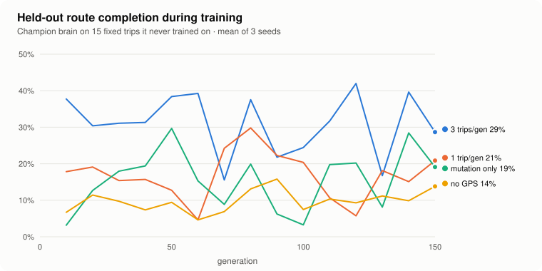

# Training experiments

Which changes to the learning setup actually help cars reach a destination they've never driven to?
These runs compare four setups using the headless trainer, [`scripts/train.js`](../../scripts/train.js).

## Method

- **Task.** Each generation, 100 cars drive a random GPS trip (150–450 m) in one of the five bundled cities, among traffic. Score = % of the route completed, plus a small bonus for arriving quickly.
- **Held-out evaluation.** Every 10 generations, the best brain drives 15 fixed trips (3 per city) that are never used for training. A trip counts as *arrived* if the car reaches the destination within 90 seconds.
- **Seeds.** Every setup ran with seeds 1, 2 and 3. The trainer seeds the app's random number generator, so a run is exactly repeatable. Rerunning `multitrip-gps` seed 2 from the same commit reproduced its log line for line. Runs with the same seed share the same evaluation trips, so setups are compared on identical trips.
- **Setups**, 150 generations each:

| Setup | Breeding | Trips per generation | GPS inputs |
| --- | --- | --- | --- |
| Crossover, 3 trips/gen | top 10 brains, uniform crossover + mutation | 3 (scores averaged) | yes |
| Crossover, 1 trip/gen | top 10 brains, uniform crossover + mutation | 1 | yes |
| Mutation only (course method) | copy the single best brain, mutate | 1 | yes |
| No GPS inputs | top 10 brains, uniform crossover + mutation | 1 | no |

## Results

<picture>
  <source media="(prefers-color-scheme: dark)" srcset="chart-dark.svg">
  
</picture>

| Setup | Route completed (mean of last 3 evals) | Arrived (mean of last 3 evals) | Best checkpoint: arrived | Best checkpoint: route | Best checkpoint per seed |
| --- | --- | --- | --- | --- | --- |
| **Crossover, 3 trips/gen** | **28%** | **10%** | **49%** | **70%** | 40% / 73% / 33% |
| Crossover, 1 trip/gen | 18% | 2% | 13% | 38% | 20% / 13% / 7% |
| Mutation only (course method) | 19% | 4% | 22% | 42% | 20% / 27% / 20% |
| No GPS inputs | 12% | 1% | 2% | 20% | 0% / 7% / 0% |

*Best checkpoint* is the evaluation with the most arrivals in each run, which is the brain you would ship. All values are means over 3 seeds except the last column. Raw logs are in the CSV files here. Regenerate the table and chart with `node scripts/analyze-experiments.js`.

## What I learned

1. **The GPS inputs matter most.** Without the two "route bends left / right" signals, cars almost never arrive (2%). A brain that only sees walls can't know which way to turn at a junction.
2. **My first idea didn't work.** I expected crossover between the top 10 brains to beat the course's copy-the-best-and-mutate approach. With one trip per generation it didn't (13% vs 22% best-checkpoint arrivals), and the curves overlap.
3. **The real problem was a noisy fitness signal.** With one trip per generation, the "best" brain is often just the one that got an easy route, and the next generation is bred from luck. Scoring every brain on **3 trips per generation** and averaging made it the clear winner on every measure: 2.2× the arrivals of mutation-only at the best checkpoint, and the highest route completion at the end of training. Each generation costs 3× the simulation time, which the headless trainer makes affordable.
4. **Results vary a lot between runs.** The same setup with a different seed scored anywhere from 33% to 73%. Hence 3 seeds per setup, and no conclusions from a single run.

## The shipped brain, measured fairly

Picking the best checkpoint *using* the evaluation trips flatters it: you are partly selecting for luck on those 15 trips. So [`data/pretrained-brain.json`](../../data/pretrained-brain.json), the seed-2 checkpoint from generation 60, was re-tested with [`scripts/evaluate.js`](../../scripts/evaluate.js) on two fresh sets of 50 trips each (10 per city), never seen during training or selection:

| Brain | Selection trips (15) | Fresh trips, seed 1000 | Fresh trips, seed 2000 |
| --- | --- | --- | --- |
| **Shipped: 3 trips/gen, seed 2, gen 60** | 73% arrived | **46%** arrived, 76% of route | **36%** arrived, 67% of route |
| Longer run: 3 trips/gen, seed 11, 250 gens | 33% arrived | 28% arrived, 48% of route | 20% arrived, 43% of route |

The honest number for the shipped brain is about **40% of unseen trips completed and ~70% of the route on average**, well below the 73% it scored on the trips used to pick it. Training longer (250 generations) did not help by itself: the longer run's best brain was worse.

## Reproduce

```
node scripts/train.js --generations 150 --seed 2 --trips-per-gen 3 --log docs/experiments/multitrip-gps-seed2.csv --out brain.json
node scripts/evaluate.js brain.json --trips 10 --seed 1000
```

A 150-generation run takes about 15–30 minutes on a laptop, depending on how many run at once.
